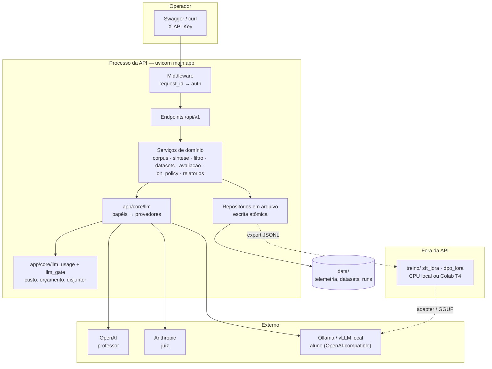
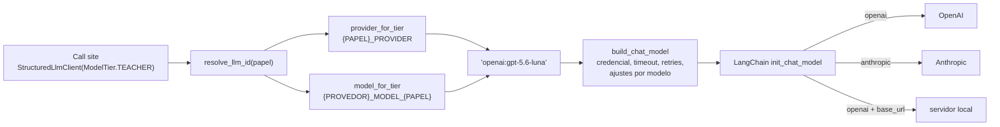
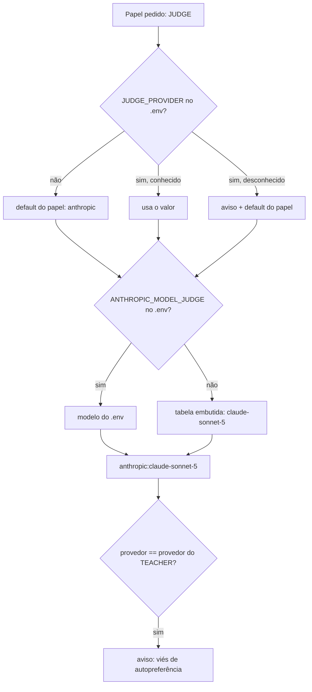
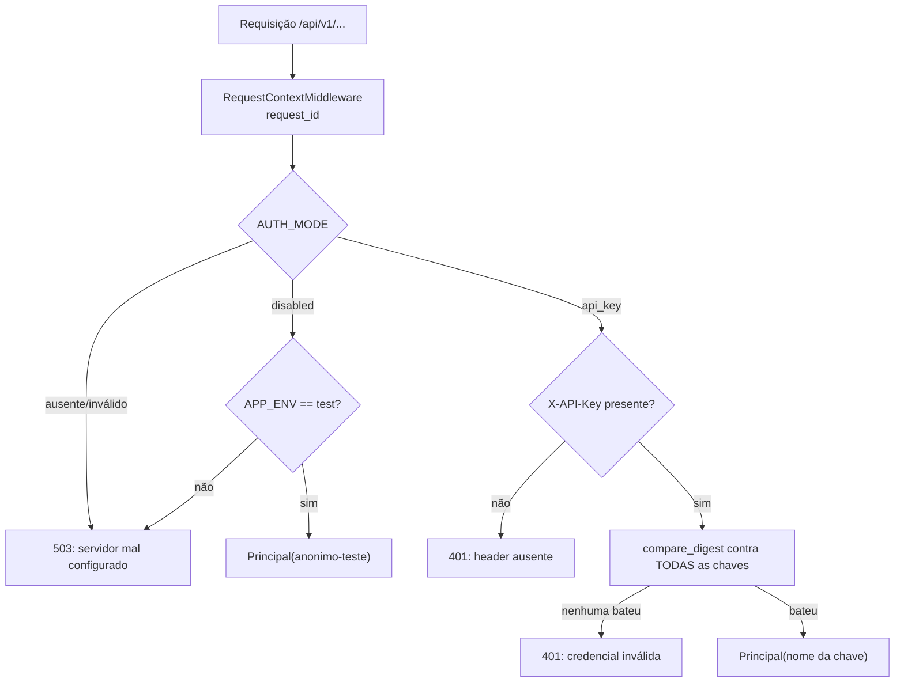
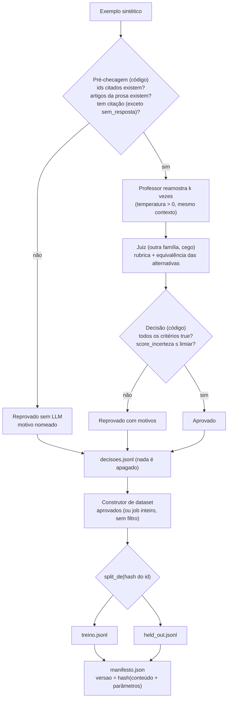
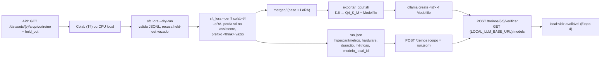
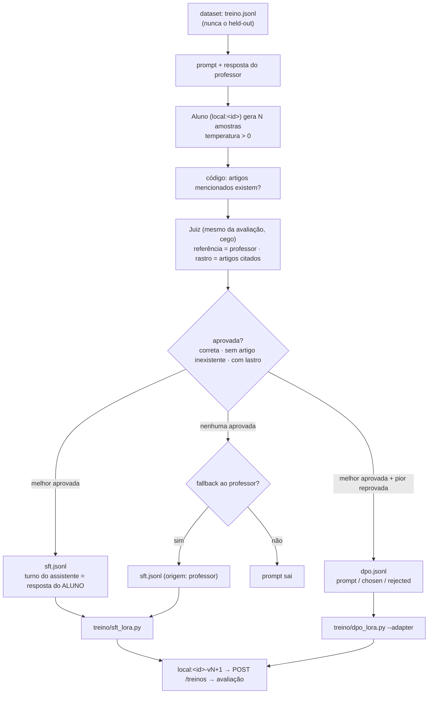
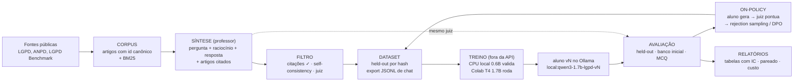
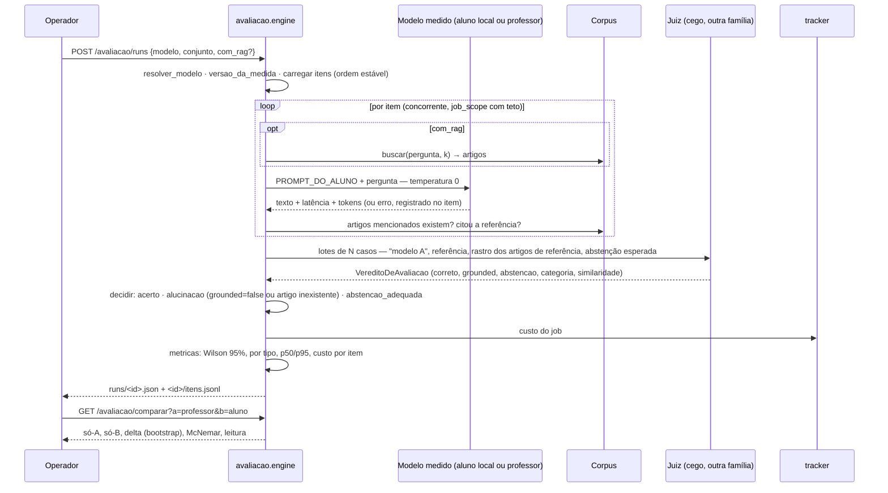

# Arquitetura — GENA (destilação de SLM em Privacidade e Proteção de Dados)

Como o sistema é construído: camadas, módulos, contratos e fluxos. Fonte da
verdade: o código em `app/`. Revisado contra a árvore de trabalho em
2026-10-18, com as cinco etapas de software entregues (fundação, corpus e
síntese, filtro e dataset, treino externo, avaliação, on-policy e relatórios).

Documento irmão: [`../README.md`](../README.md) (como rodar).

---

## 1. Visão geral

API **FastAPI** assíncrona, single-tenant, que orquestra um pipeline de
pesquisa: um LLM **professor** por API gera dados sintéticos sobre a LGPD;
um LLM **juiz** de outra família filtra e avalia; um SLM **aluno** local é
treinado **fora da API** (CPU local ou Colab) e medido pelo mesmo juiz.



Princípios herdados do projeto de referência (Incubadora de Agentes):

- **Camada única de provedor.** Só `app/core/llm.py` conhece nomes de
  modelo. Call sites pedem um **papel**.
- **Contratos em `Protocol`, dublês em teste.** Nenhum teste da suíte
  default fala com a rede.
- **Saída estruturada validada**, consumo contabilizado **antes** da
  validação, retentativa só em erro de validação.
- **Verificação determinística por cima do juiz.** O LLM julga; regras em
  código (citações existem? abstenção onde devia?) decidem o que o LLM não
  pode.
- **Held-out por construção**, não por disciplina: split por hash do id.
- **Ausência declarada > número inventado.** Modelo sem preço aparece como
  "sem preço", nunca como custo zero.

---

## 2. Camadas e módulos

### 2.1 Transporte e segurança

| Módulo | Responsabilidade |
|---|---|
| `app/main.py` | Monta o FastAPI, registra middleware, handlers de erro e o roteador v1; `/health/live` e `/health/ready` |
| `app/core/observability.py` | `RequestContextMiddleware` (ASGI puro): `request_id` por requisição, header `X-Request-Id`, linha de acesso; `JsonLogFormatter` com `LOG_FORMAT=json` |
| `app/core/auth.py` | `AUTH_MODE=api_key` (header `X-API-Key` contra `AUTH_API_KEYS`, comparação em tempo constante) ou `disabled` (só com `APP_ENV=test`). Ausente → 503 em tudo |
| `app/api/v1/router.py` | Dependência de autenticação **no roteador**: rota nova nasce protegida |
| `app/core/erros.py` | Exceções de domínio → HTTP: `OrcamentoExcedido` 409, `SaturacaoDoProvedor` 503 + `Retry-After`, `StructuredOutputError` 502 |
| `app/core/config.py` | Leitura tipada do `.env` (funções, não objeto congelado: `monkeypatch` nos testes vê o valor novo) |

### 2.2 Camada de LLM (`app/core/llm.py`)



**Papéis** (`ModelTier`): `TEACHER`, `JUDGE`, `STUDENT`. Cada papel tem
provedor próprio (`TEACHER_PROVIDER` etc.; defaults `openai`, `anthropic`,
`local`) e modelo por `{PROVEDOR}_MODEL_{PAPEL}` (ex.:
`OPENAI_MODEL_TEACHER=gpt-5.6-luna`). Todo provedor atende todo papel, o que
permite medir o professor como "aluno" (condição C0) ou usar um modelo local
como juiz num teste de fumaça.

**Identidade**: `provedor:modelo`, separada no **primeiro** `:` (tags do
Ollama têm `:` no nome: `local:qwen3:1.7b`). Override sem prefixo é
recusado; não há provedor legado a assumir.

**Provedor `local`**: transporte `openai` com `base_url=LOCAL_LLM_BASE_URL`
e token placeholder. Um aluno treinado vira um id novo
(`local:qwen3-1.7b-lgpd-v2`); rollback é reescrever a string.

**Ajustes por modelo, observados contra a API** (nunca adivinhados):

| Modelo | Ajuste | Motivo |
|---|---|---|
| `gpt-5.6-luna` | `use_responses_api=True` | Ferramentas e `usage_metadata` só pela Responses API |
| `gpt-5.6-luna` | `max_tokens += 8192` | Raciocínio sai do mesmo teto de saída; sem reserva o JSON chega truncado |
| `gpt-5.6-luna` | `prompt_cache_options={"mode":"explicit"}` quando `sem_cache_de_prompt` | Cobra a escrita de cache; chamada sem prefixo reusável não deve pagar |
| `claude-sonnet-5` | `temperature` removida do payload, com aviso único | Recusa o parâmetro com 400 |

**Saída estruturada**: `with_structured_output(method="json_schema",
include_raw=True)`. `json_schema` é decodificação restrita de verdade;
`include_raw` preserva a `AIMessage` e com ela o `usage_metadata`.
`ainvoke_structured` contabiliza o consumo **antes** de validar, retenta
uma vez só em `StructuredOutputError`, e não reamostra quando a resposta
foi truncada pelo teto (a segunda tentativa truncaria no mesmo ponto).

**Prompt caching**: `system_message(..., cacheable=True)` e
`user_message(..., cacheable_prefix=...)` marcam `cache_control` na
Anthropic; OpenAI cacheia por prefixo sozinha.

**`StructuredLlmClient`**: cliente lazy por `(model_id, max_tokens)`,
temperatura 0 por default, `parse()` para saída validada e `text()` para
prosa (é assim que o aluno é medido: exigir JSON dele mediria formato, não
conteúdo).

### 2.3 Custo: preço, telemetria e portão

| Módulo | O que faz |
|---|---|
| `llm_pricing.py` | USD por 1M tokens por modelo (`input`, `output`, `cache_write`, `cache_read`, `verified`). Desconhecido → `None`; `local:*` → zero (fato, não lacuna). Override `LLM_PRICING_JSON` |
| `llm_usage.py` | `tracker.record(...)` agrega por **etapa** (`Etapa`: corpus, sintese, filtro, dataset, treino, avaliacao, diagnostico) × **modelo** e por **job**. `etapa_scope`/`job_scope` (ContextVars) atribuem sem cada call site saber. Espelho em `DATA_DIR/llm_usage.json` |
| `llm_gate.py` | `portao_do_llm` envolve toda chamada: **disjuntor** por provedor (abre após N falhas 429/5xx seguidas; erro 4xx não abre) e **orçamento** por job (custo real acumulado + estimativa da entrada desta chamada > teto → `OrcamentoExcedido` sem sair para a rede) |

### 2.4 Persistência

`app/repositories/_file_store.py`: `escrever_json_atomico` (tmp +
`os.replace` com retry para o lock transitório do Windows), `ler_json`,
`acrescentar_jsonl`, `ler_jsonl`. Uma instância do processo; se isso mudar,
SQLite.

### 2.5 Endpoints existentes

| Rota | Função |
|---|---|
| `GET /health/live` | Processo responde |
| `GET /health/ready` | 200/503 com `checks`: `auth_mode`, `data_dir`, credenciais do professor e do juiz, `servidor_local_do_aluno`, `avisos` |
| `GET /api/v1/usage/llm` | Agregado por etapa/modelo/job, total, `modelos_sem_preco`, `modelos_com_preco_nao_conferido` |
| `GET /api/v1/usage/providers` | Provedor, modelo, origem (`env`/`default`), variável a mexer e credencial de cada papel; `avisos` |
| `POST /api/v1/usage/ping/{papel}` | **Uma** chamada estruturada real ao modelo do papel; devolve latência e custo estimado |
| `POST /api/v1/corpus/ingerir` | Lê `recursos/fontes/<fonte>.txt`, chunka por dispositivo, persiste em `DATA_DIR/corpus/`; idempotente |
| `GET /api/v1/corpus` | Resumo do corpus ativo (artigos, parágrafos, incisos, alíneas) |
| `GET /api/v1/corpus/dispositivos/{id}` | Um dispositivo e o artigo inteiro remontado |
| `GET /api/v1/corpus/buscar?q=&k=` | Recuperação BM25 sobre artigos |
| `POST /api/v1/sintese/jobs` | Cria um job de síntese e o executa em segundo plano (202) |
| `GET /api/v1/sintese/jobs[/{id}]` | Lista ou acompanha: status, contadores, descartes por motivo, custo |
| `GET /api/v1/sintese/jobs/{id}/exemplos` · `/descartados` | Inspeção humana do que o professor produziu |
| `POST /api/v1/filtro/jobs` | Filtra exemplos de jobs de síntese em segundo plano (202) |
| `GET /api/v1/filtro/jobs[/{id}]` · `/{id}/decisoes?aprovado=` | Status, contadores, reprovações por motivo; decisões com veredito e reamostragens |
| `POST /api/v1/datasets` | Constrói uma versão (síncrono, 201) a partir de aprovados do filtro e/ou jobs de síntese inteiros |
| `GET /api/v1/datasets[/{versao}]` · `/{versao}/amostra` · `/{versao}/arquivo/{split}` | Manifesto, amostra de linhas e download do JSONL |
| `POST /api/v1/treinos` | Registra um run (corpo = `run.json` do script); exige dataset conhecido; recusa id local já ocupado por run concluído |
| `GET /api/v1/treinos[/{id}]` · `POST /{id}/verificar` | Lista/obtém runs; `verificar` consulta o servidor local e marca `disponivel_localmente` |
| `POST /api/v1/avaliacao/runs` | Avalia um modelo (papel ou id qualificado) num conjunto, em segundo plano (202) |
| `GET /api/v1/avaliacao/runs[/{id}]` · `/{id}/itens?so_erros=` | Status e métricas; itens com resposta, verificação e veredito |
| `GET /api/v1/avaliacao/comparar?a=&b=` | Comparação pareada item a item entre dois runs |
| `POST /api/v1/avaliacao/runs/{id}/anotacoes` · `GET /{id}/anotacoes?anotador=` · `GET /{id}/calibracao` | Anotação humana de um item; lista (por anotador) para a tela pular o já anotado; kappa juiz × humanos e entre humanos |
| `GET /ui/` (e `/` redireciona) | Front estático, público; a chave vai em cada chamada à API |
| `POST /api/v1/on-policy/jobs` · `GET /jobs[/{id}]` · `/{id}/amostras` · `/{id}/arquivo/{sft\|dpo\|amostras}` | Rodada on-policy em segundo plano; amostras julgadas; arquivos de treino |
| `GET /api/v1/relatorios/condicoes[.md]?runs=&rotulos=` · `/pareadas?referencia=&candidatos=` · `/custos` | Tabela das condições (JSON/Markdown), comparações contra uma referência, custo por etapa |

---

## 3. Serviços de domínio

### 3.1 Corpus (`app/services/corpus/`)

| Módulo | Responsabilidade |
|---|---|
| `chunking.py` | Texto limpo da lei → `Dispositivo` com id canônico (`LGPD:art.7:inc.IX`, `LGPD:art.48:par.1`, `LGPD:art.11:inc.II:ali.c`, `LGPD:art.55-A`), hierarquia artigo > parágrafo > inciso > alínea, capítulo e seção. Linha sem marcador é continuação; nada é inventado |
| `referencias.py` | Referência em texto livre ("arts. 7º, IV; 11, II, “c”; 13 e 16") → ids, por varredura sequencial de tokens; `artigos_mencionados` extrai artigos de uma resposta em prosa |
| `retrieval.py` | BM25 próprio (~60 linhas) sobre artigos remontados; tokenização sem acento e sem stopwords; ranking determinístico |
| `ingestao.py` | `Corpus` em memória (índice por id, `texto_do_artigo`, `buscar`, `relacionados`), `ingerir` e o registro por processo |
| `scripts/baixar_lgpd.py` | Baixa o HTML consolidado do Planalto, descarta redação revogada (`<strike>`, `line-through`) e anotações editoriais, grava `recursos/fontes/lgpd.txt` versionado |

Resultado medido em 2026-10-18: 79 artigos, 452 dispositivos; todas as
referências do banco inicial de perguntas resolvem para ids existentes.

### 3.2 Síntese (`app/services/sintese/`) — o RAG da pesquisa

| Módulo | Responsabilidade |
|---|---|
| `taxonomia.py` | Oito tipos de tarefa com objetivo e instrução ao professor; `sem_resposta` ensina abstenção |
| `llm_service.py` | `SinteseLLMService` (Protocol) + `LlmSinteseService` (papel `TEACHER`, um lote de N pedidos por chamada); `VERSAO_DO_PROMPT` = hash do system prompt |
| `dedup.py` | Jaccard sobre tokens normalizados contra o próprio job e contra o **banco inicial** (vazamento) |
| `gerador.py` | Engine: plano com seed, contexto RAG (alvo + relacionados por BM25), lotes concorrentes sob `job_scope`/`etapa_scope`, pós-processamento determinístico, persistência |
| `app/services/injecao.py` | `GUARDRAIL` no prompt e `marca_de_injecao` na saída |

O que o professor decide: pergunta, raciocínio e resposta. O que o código
decide: quais artigos ele vê, se as citações existem (`citacoes_validas`),
se o exemplo é duplicata ou vaza a prova, se há marca de injeção, e o
destino (aceito ou descartado com motivo). Nada é apagado.

### 3.3 Filtro (`app/services/filtro/`)

| Módulo | Responsabilidade |
|---|---|
| `engine.py` | `pre_checagem` (sem LLM: ids citados existem, artigos mencionados na prosa existem, tipo que exige fundamentação tem citação); reamostragem k vezes; julgamento em lote; `score_incerteza` = 1 − fração de reamostragens equivalentes; decisão por regra com motivos nomeados |
| `llm_service.py` | `FiltroLLMService` (Protocol): `reamostrar` (papel `TEACHER`, temperatura > 0, **mesmo contexto da síntese**) e `julgar` (papel `JUDGE`, rubrica: correção, lastro, completude, abstenção, dado pessoal, nota, equivalência das alternativas); juiz cego ("modelo A"); `VERSAO_DO_FILTRO` = hash dos prompts + campos da rubrica |

Reprovado na pré-checagem não vai ao LLM. O juiz pontua; quem decide é a
regra em código. Decisões ficam todas gravadas, aprovadas ou não.

### 3.4 Datasets (`app/services/datasets/`)

| Módulo | Responsabilidade |
|---|---|
| `prompt_do_aluno.py` | O system prompt do aluno, **byte a byte o mesmo** no treino e na avaliação; `resposta_de_treino` monta "Raciocínio / Resposta" ou só a resposta (condição de controle) |
| `split.py` | `split_de(id, fração)` por hash do id: o mesmo exemplo cai sempre no mesmo lado, em qualquer versão |
| `construtor.py` | Coleta aprovados de jobs de filtro e/ou jobs de síntese inteiros, deduplica por id, divide, exporta JSONL de chat e grava o manifesto; `versao` = hash do conteúdo ordenado + parâmetros |

### 3.5 Laço de lotes (`app/services/lotes.py`)

`ExecutorDeLotes`: semáforo de concorrência, `OrcamentoExcedido` para o
job preservando o que já saiu, outra exceção conta como lote com erro e o
job segue, consolidação sob lock. Usado por síntese e filtro; a avaliação
vai usar o mesmo.

### 3.6 Treino (`treino/` fora da API; `app/services/treino/` dentro)

| Módulo | Responsabilidade |
|---|---|
| `treino/preparacao.py` | Perfis por hardware (`cpu-local` 0.6B fp32; `colab-t4` 1.7B fp16; `colab-t4-4bit` 4B), leitura/validação do JSONL, prefixo do assistente, `run.json` |
| `treino/sft_lora.py` | SFT com LoRA (TRL + PEFT), formato prompt/completion com perda só no assistente, merge, `--dry-run`; aborta se um id do held-out estiver no treino |
| `treino/exportar_gguf.sh` · `Modelfile.template` | Merged → GGUF f16 → Q4_K_M; template ChatML do Qwen3 com o mesmo prefixo `<think>` vazio do treino; sem `SYSTEM` |
| `treino/colab_treino_lgpd.ipynb` | O fluxo no Colab, célula a célula |
| `app/services/treino/registro.py` | `registrar` e `verificar` (lista `GET {LOCAL_LLM_BASE_URL}/models`, aceita nome com tag `:latest`) |

É o único lugar onde nomes de modelo-base aparecem fora de `app/core/llm.py`,
por ser receita externa à API. O `run.json` que o script grava **é** o corpo
de `POST /treinos`.

### 3.7 Avaliação (`app/services/avaliacao/`)

| Módulo | Responsabilidade |
|---|---|
| `conjuntos.py` | `BANCO_INICIAL` (34 itens; referência = critérios esperados; gold = artigos da referência; Teste C espera abstenção) e `HELD_OUT` de um dataset (referência = resposta do professor sem o raciocínio; gold = artigos citados). Ordem estável; `versao_do_conjunto` |
| `llm_service.py` | `AvaliacaoLLMService` (Protocol): `responder` (modelo medido, papel `STUDENT` com override, `PROMPT_DO_ALUNO`, temperatura 0, RAG opcional) e `julgar` (papel `JUDGE`, cego, rastro = artigos de referência, eixos independentes `correto`/`grounded`/`abstencao`, categoria de erro); `VERSAO_DO_JUIZ` |
| `engine.py` | Resolve o modelo, carrega itens, respostas concorrentes com latência e tokens por item, `verificar` (artigos mencionados existem? citou a referência?), julgamento em lotes, decisão por regra, métricas; `versao_da_medida` = hash(juiz + prompt do aluno + regras + conjunto + RAG) |
| `metricas.py` | Funções puras: acurácia e taxa de alucinação com Wilson 95%, abstenções adequadas, critérios da rubrica, categorias, por tipo, latência p50/p95, tokens, custo por item |
| `pareado.py` | Itens em comum, só-A/só-B, delta com bootstrap, McNemar exato, leitura em uma frase; marca comparação indicativa quando as versões da medida divergem |
| `app/core/stats.py` | Wilson, McNemar exato, bootstrap pareado, kappa de Cohen (para a calibração humana), percentil |

O modelo medido **não** entra na versão da medida: é o que permite comparar
professor e aluno na mesma régua. Item com erro de provedor fica fora do
denominador e visível no `itens.jsonl`.

### 3.8 On-policy (`app/services/on_policy/`)

| Módulo | Responsabilidade |
|---|---|
| `llm_service.py` | `OnPolicyLLMService` (Protocol): `amostrar` (aluno, papel `STUDENT` com override, temperatura > 0, `PROMPT_DO_ALUNO`) e `julgar` (o **mesmo** `JuizLlm` da avaliação, mesma rubrica e versão) |
| `engine.py` | Prompts só do split de **treino**; N amostras por prompt; verificação de artigos inexistentes; julgamento em lotes contra a resposta do professor com rastro; `aprovada` = correta, sem artigo inexistente e, se exigido, com lastro; `selecionar` (função pura): SFT com a melhor aprovada ou fallback ao professor, par DPO (melhor aprovada, pior reprovada) |
| `treino/dpo_lora.py` | DPO com LoRA sobre `dpo.jsonl`, continuando o adapter do SFT; mesmo prefixo nos dois lados do par; `--dry-run`; `run.json` = `POST /treinos` |

### 3.9 Calibração humana (`app/services/avaliacao/calibracao.py`)

Anotações por (anotador, item) com `correto` e `grounded` na mesma definição
da rubrica. Resumo: kappa por anotador contra o juiz, kappa do juiz contra o
voto da **maioria** (itens com ≥ 2 anotadores; empate descarta), kappa médio
entre humanos como teto, e leitura na escala de Landis & Koch. Reanotar o
mesmo item substitui.

### 3.10 Relatórios (`app/services/relatorios/`)

`condicoes.tabela` e `condicoes.markdown`: uma linha por run com rótulo da
condição, acurácia e alucinação com IC de 95%, abstenções, citação da
referência, latência p50 e custo por item; aviso quando as versões da medida
divergem. `/relatorios/pareadas` reusa `pareado.comparar`; `/relatorios/custos`
reusa a telemetria.

### 3.11 Front mínimo (`app/ui/`)

`index.html`, `app.js` e `app.css` servidos por `StaticFiles` em `/ui`. JS
puro, sem framework nem build; a chave de API fica em `sessionStorage` e vai
no header de cada `fetch`. Três telas: **Anotação** (calibração do juiz, com
o veredito escondido por padrão e o rastro dos artigos buscado em
`/corpus/dispositivos`), **Inspeção** (exemplos, descartes, decisões,
amostras e itens com erro, paginados) e **Painel** (saúde, custos, jobs,
runs com métricas, comparação pareada e tabela das condições). Nenhuma rota
de negócio nova: o front só compõe endpoints existentes. Síntese, filtro e
treino não são disparados pelo front de propósito.

### 3.12 A forma comum dos serviços com LLM

Todo serviço que fala com um modelo segue o mesmo padrão:

```python
class SinteseLLMService(Protocol):               # contrato de dominio
    async def gerar(self, pedidos: list[PedidoDeExemplo]) -> list[ExemploGerado]: ...

class LlmSinteseService:                         # unica implementacao concreta
    def __init__(self, model: str | None = None):
        self._llm = StructuredLlmClient(ModelTier.TEACHER, max_tokens=..., etapa=Etapa.SINTESE, override=model)
```

Prompts são constantes de módulo, **versionadas por hash**. O engine faz
batching e concorrência por cima do serviço (`app/services/lotes.py`); os
testes usam um dublê do `Protocol` e nunca falam com a rede.

---

## 4. Dicionário de dados

| Artefato | Onde | Chave | Estado |
|---|---|---|---|
| Dispositivo do corpus | `data/corpus/<fonte>.jsonl` (+ `manifesto.json`) | `id` canônico | existe |
| Job de síntese | `data/sintese/jobs/<job_id>.json` | `id` | existe |
| Exemplo sintético aceito | `data/sintese/<job_id>/exemplos.jsonl` | `id` = hash(tokens da pergunta); grava `versao_do_prompt`, `modelo`, `contexto_ids`, `citacoes_validas` | existe |
| Exemplo descartado | `data/sintese/<job_id>/descartados.jsonl` | `motivo` ∈ {indice_desconhecido, marca_de_injecao, pergunta_curta, duplicata_no_job, vazamento_do_banco_inicial} | existe |
| Job de filtro | `data/filtro/jobs/<job_id>.json` | `id` | existe |
| Decisão do filtro | `data/filtro/<job_id>/decisoes.jsonl` | `exemplo_id`; `aprovado`, `score_incerteza`, `motivos`, `veredito`, `reamostragens`, `versao_do_filtro` | existe |
| Versão de dataset | `data/datasets/<versao>/{treino,held_out}.jsonl` + `manifesto.json` | `versao` = hash(linhas ordenadas + parâmetros + prompt do aluno) | existe |
| Run de treino | `data/treinos/<run_id>.json` | `id`; `dataset_versao`, `modelo_base`, `hiperparametros`, `hardware`, `metricas`, `modelo_local_id`, `disponivel_localmente` | existe |
| Run de avaliação | `data/avaliacao/runs/<run_id>.json` (métricas) + `data/avaliacao/<run_id>/itens.jsonl` (resposta, verificação, veredito por item) | `id`; grava `versao_da_medida`, `modelo`, `modelo_juiz` | existe |
| Anotação humana | `data/avaliacao/<run_id>/anotacoes.jsonl` | (anotador, item_id); a última vale | existe |
| Job on-policy | `data/on_policy/jobs/<id>.json` + `<id>/{amostras,sft,dpo}.jsonl` | `id`; `sft` no formato de chat, `dpo` em prompt/chosen/rejected | existe |
| Telemetria | `data/llm_usage.json` | etapa × modelo; job | existe |

---

## 5. Operação

- **Boot**: `verificar_configuracao()` loga a lacuna de `AUTH_MODE`;
  `lifespan` cria `DATA_DIR`, loga os `avisos_de_configuracao` da camada
  de LLM e marca como `falhou` todo job de síntese, filtro ou avaliação que
  ficou `pendente`/`executando` quando o processo anterior morreu
  (`app/services/jobs_interrompidos.py`). O que foi gravado em disco fica.
- **Variáveis**: inventário comentado em `.env.example`; as decisivas no
  README.
- **Logs**: `LOG_FORMAT=json` para uma linha JSON por evento com
  `request_id`.
- **Limites**: `LLM_BUDGET_USD_POR_JOB`, `LLM_TIMEOUT_S`, `LLM_MAX_RETRIES`,
  `LLM_CIRCUIT_FAILURES`, `LLM_CIRCUIT_COOLDOWN_S`.
- **Qualidade**: `pytest` (sem rede), `pyflakes`, `radon cc -n D` vazio; CI
  em `.github/workflows/ci.yml`.

---

## 6. Fluxos explicativos

### 6.1 Uma chamada de LLM, do call site ao provedor

```mermaid
sequenceDiagram
    participant S as Serviço (ex.: síntese)
    participant C as StructuredLlmClient
    participant G as llm_gate.portao_do_llm
    participant U as llm_usage.tracker
    participant P as Provedor (OpenAI)

    S->>C: parse(Schema, system, user)
    C->>C: model_id = resolve_llm_id(TEACHER)
    C->>C: build_chat_model (lazy, por max_tokens)
    C->>G: entrar(model_id, messages)
    G->>G: disjuntor fechado?
    G->>U: custo_do_job(job corrente)
    G->>G: acumulado + entrada estimada ≤ teto?
    alt estourou
        G-->>S: OrcamentoExcedido (409) — nada enviado
    end
    G->>P: ainvoke(messages) com json_schema
    P-->>G: {raw: AIMessage, parsed, parsing_error}
    G->>G: sucesso → zera falhas; 429/5xx → conta falha
    C->>U: record_langchain_usage(raw) — ANTES de validar
    alt parsing_error
        C->>P: reamostra uma vez (não se truncado)
    end
    C-->>S: Schema validado
```

### 6.2 Como um papel vira um modelo concreto



### 6.3 Autenticação de uma requisição



### 6.4 Síntese ancorada em recuperação (RAG): um job de ponta a ponta

```mermaid
sequenceDiagram
    participant O as Operador
    participant E as sintese.gerador
    participant C as Corpus (BM25)
    participant P as Professor (OpenAI)
    participant R as SinteseRepository

    O->>E: POST /sintese/jobs {quantidade, tipos, seed, lote}
    E->>E: planejar: sorteia artigos (seed), cicla tipos e dificuldades
    loop por pedido
        E->>C: texto_do_artigo(alvo) + relacionados(alvo, k=2)
        C-->>E: contexto com ids canônicos
    end
    loop por lote (concorrência limitada, job_scope com teto)
        E->>P: system (regras + taxonomia + guardrail) + N pedidos com contexto
        P-->>E: N exemplos {indice, pergunta, raciocinio, resposta, artigos_citados}
        E->>E: marca_de_injecao? pergunta curta? duplicata? vazamento do banco inicial?
        E->>C: cada id citado existe?
        E->>R: exemplos.jsonl (aceitos, com citacoes_validas) e descartados.jsonl (motivo)
        E->>R: job.json (contadores, custo acumulado)
    end
    alt OrcamentoExcedido
        E->>R: status=orcamento_excedido; o que já saiu fica
    end
    O->>E: GET /sintese/jobs/{id}/exemplos — inspeção humana
```

### 6.5 Filtro e dataset: do exemplo gerado ao arquivo de treino



### 6.6 Treino: do JSONL exportado ao modelo servido



### 6.7 Autodestilação on-policy



### 6.8 Pipeline da pesquisa ponta a ponta



### 6.9 Avaliação de um modelo


