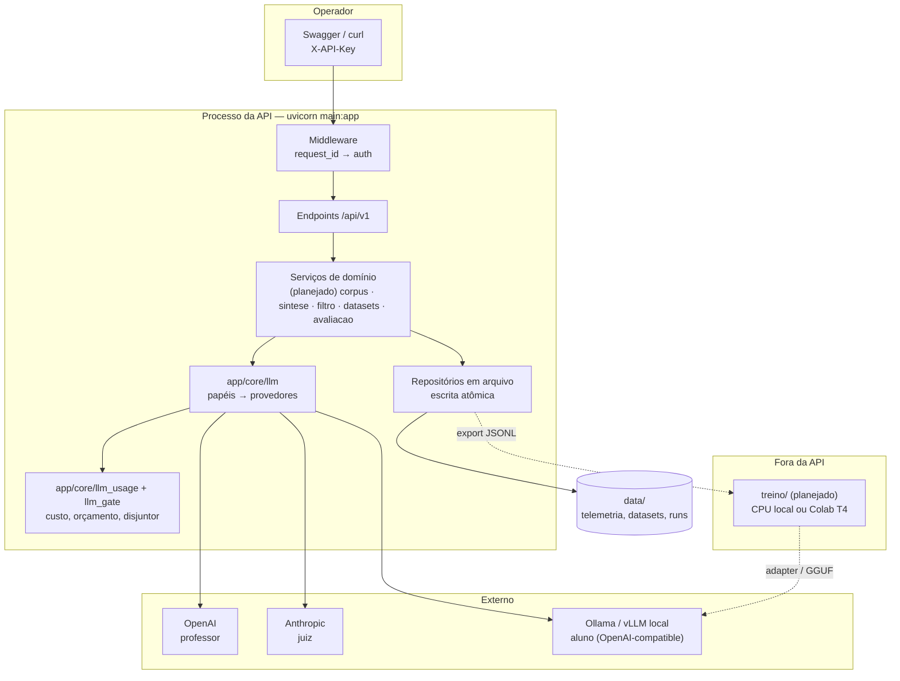
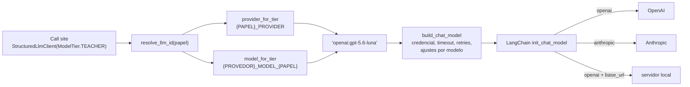
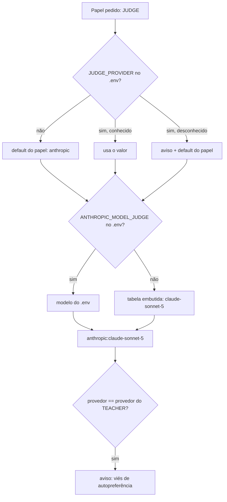
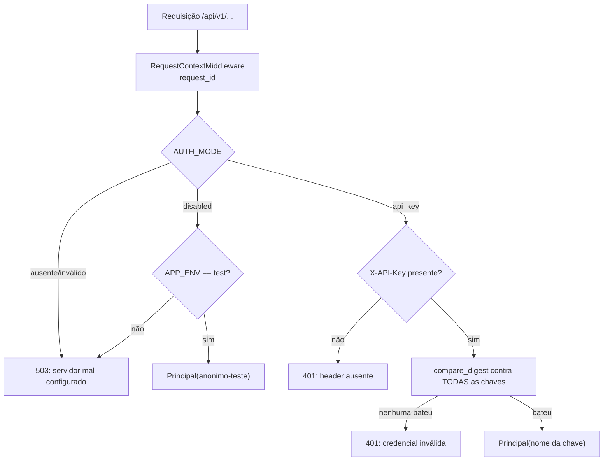
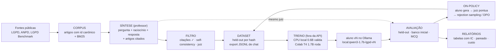
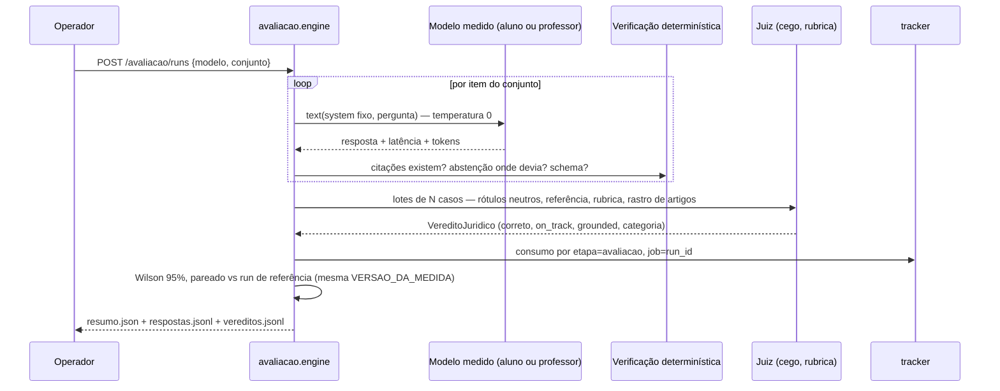

# Arquitetura — GENA (destilação de SLM em Privacidade e Proteção de Dados)

Como o sistema é construído: camadas, módulos, contratos e fluxos. Fonte da
verdade: o código em `app/`. Revisado contra a árvore de trabalho em
2026-10-18 (Etapa 0). As seções marcadas **(planejado)** descrevem o que as
etapas seguintes acrescentam, no formato em que vão nascer; o que já existe
não leva marca.

Documentos irmãos: [`PLANO_DE_IMPLEMENTACAO.md`](PLANO_DE_IMPLEMENTACAO.md)
(por que e em que ordem), [`HISTORICO_DECISOES.md`](HISTORICO_DECISOES.md)
(decisões com data e medição) e [`../README.md`](../README.md) (como rodar).

---

## 1. Visão geral

API **FastAPI** assíncrona, single-tenant, que orquestra um pipeline de
pesquisa: um LLM **professor** por API gera dados sintéticos sobre a LGPD;
um LLM **juiz** de outra família filtra e avalia; um SLM **aluno** local é
treinado **fora da API** (CPU local ou Colab) e medido pelo mesmo juiz.



Princípios herdados do projeto de referência (Incubadora de Agentes):

- **Camada única de provedor.** Só `app/core/llm.py` conhece nomes de
  modelo. Call sites pedem um **papel**.
- **Contratos em `Protocol`, dublês em teste.** Nenhum teste da suíte
  default fala com a rede.
- **Saída estruturada validada**, consumo contabilizado **antes** da
  validação, retentativa só em erro de validação.
- **Verificação determinística por cima do juiz.** O LLM julga; regras em
  código (citações existem? abstenção onde devia?) decidem o que o LLM não
  pode.
- **Held-out por construção**, não por disciplina **(planejado)**.
- **Ausência declarada > número inventado.** Modelo sem preço aparece como
  "sem preço", nunca como custo zero.

---

## 2. Camadas e módulos

### 2.1 Transporte e segurança

| Módulo | Responsabilidade |
|---|---|
| `app/main.py` | Monta o FastAPI, registra middleware, handlers de erro e o roteador v1; `/health/live` e `/health/ready` |
| `app/core/observability.py` | `RequestContextMiddleware` (ASGI puro): `request_id` por requisição, header `X-Request-Id`, linha de acesso; `JsonLogFormatter` com `LOG_FORMAT=json` |
| `app/core/auth.py` | `AUTH_MODE=api_key` (header `X-API-Key` contra `AUTH_API_KEYS`, comparação em tempo constante) ou `disabled` (só com `APP_ENV=test`). Ausente → 503 em tudo |
| `app/api/v1/router.py` | Dependência de autenticação **no roteador**: rota nova nasce protegida |
| `app/core/erros.py` | Exceções de domínio → HTTP: `OrcamentoExcedido` 409, `SaturacaoDoProvedor` 503 + `Retry-After`, `StructuredOutputError` 502 |
| `app/core/config.py` | Leitura tipada do `.env` (funções, não objeto congelado: `monkeypatch` nos testes vê o valor novo) |

### 2.2 Camada de LLM (`app/core/llm.py`)



**Papéis** (`ModelTier`): `TEACHER`, `JUDGE`, `STUDENT`. Cada papel tem
provedor próprio (`TEACHER_PROVIDER` etc.; defaults `openai`, `anthropic`,
`local`) e modelo por `{PROVEDOR}_MODEL_{PAPEL}` (ex.:
`OPENAI_MODEL_TEACHER=gpt-5.6-luna`). Todo provedor atende todo papel, o que
permite medir o professor como "aluno" (condição C0) ou usar um modelo local
como juiz num teste de fumaça.

**Identidade**: `provedor:modelo`, separada no **primeiro** `:` (tags do
Ollama têm `:` no nome: `local:qwen3:1.7b`). Override sem prefixo é
recusado; não há provedor legado a assumir.

**Provedor `local`**: transporte `openai` com `base_url=LOCAL_LLM_BASE_URL`
e token placeholder. Um aluno treinado vira um id novo
(`local:qwen3-1.7b-lgpd-v2`); rollback é reescrever a string.

**Ajustes por modelo, observados contra a API** (nunca adivinhados):

| Modelo | Ajuste | Motivo |
|---|---|---|
| `gpt-5.6-luna` | `use_responses_api=True` | Ferramentas e `usage_metadata` só pela Responses API |
| `gpt-5.6-luna` | `max_tokens += 8192` | Raciocínio sai do mesmo teto de saída; sem reserva o JSON chega truncado |
| `gpt-5.6-luna` | `prompt_cache_options={"mode":"explicit"}` quando `sem_cache_de_prompt` | Cobra a escrita de cache; chamada sem prefixo reusável não deve pagar |
| `claude-sonnet-5` | `temperature` removida do payload, com aviso único | Recusa o parâmetro com 400 |

**Saída estruturada**: `with_structured_output(method="json_schema",
include_raw=True)`. `json_schema` é decodificação restrita de verdade;
`include_raw` preserva a `AIMessage` e com ela o `usage_metadata`.
`ainvoke_structured` contabiliza o consumo **antes** de validar, retenta
uma vez só em `StructuredOutputError`, e não reamostra quando a resposta
foi truncada pelo teto (a segunda tentativa truncaria no mesmo ponto).

**Prompt caching**: `system_message(..., cacheable=True)` e
`user_message(..., cacheable_prefix=...)` marcam `cache_control` na
Anthropic; OpenAI cacheia por prefixo sozinha.

**`StructuredLlmClient`**: cliente lazy por `(model_id, max_tokens)`,
temperatura 0 por default, `parse()` para saída validada e `text()` para
prosa (é assim que o aluno é medido: exigir JSON dele mediria formato, não
conteúdo).

### 2.3 Custo: preço, telemetria e portão

| Módulo | O que faz |
|---|---|
| `llm_pricing.py` | USD por 1M tokens por modelo (`input`, `output`, `cache_write`, `cache_read`, `verified`). Desconhecido → `None`; `local:*` → zero (fato, não lacuna). Override `LLM_PRICING_JSON` |
| `llm_usage.py` | `tracker.record(...)` agrega por **etapa** (`Etapa`: corpus, sintese, filtro, dataset, treino, avaliacao, diagnostico) × **modelo** e por **job**. `etapa_scope`/`job_scope` (ContextVars) atribuem sem cada call site saber. Espelho em `DATA_DIR/llm_usage.json` |
| `llm_gate.py` | `portao_do_llm` envolve toda chamada: **disjuntor** por provedor (abre após N falhas 429/5xx seguidas; erro 4xx não abre) e **orçamento** por job (custo real acumulado + estimativa da entrada desta chamada > teto → `OrcamentoExcedido` sem sair para a rede) |

### 2.4 Persistência

`app/repositories/_file_store.py`: `escrever_json_atomico` (tmp +
`os.replace` com retry para o lock transitório do Windows), `ler_json`,
`acrescentar_jsonl`, `ler_jsonl`. Uma instância do processo; se isso mudar,
SQLite (ver `HISTORICO_DECISOES.md`).

### 2.5 Endpoints existentes

| Rota | Função |
|---|---|
| `GET /health/live` | Processo responde |
| `GET /health/ready` | 200/503 com `checks`: `auth_mode`, `data_dir`, credenciais do professor e do juiz, `servidor_local_do_aluno`, `avisos` |
| `GET /api/v1/usage/llm` | Agregado por etapa/modelo/job, total, `modelos_sem_preco`, `modelos_com_preco_nao_conferido` |
| `GET /api/v1/usage/providers` | Provedor, modelo, origem (`env`/`default`), variável a mexer e credencial de cada papel; `avisos` |
| `POST /api/v1/usage/ping/{papel}` | **Uma** chamada estruturada real ao modelo do papel; devolve latência e custo estimado |

---

## 3. Serviços de domínio (planejado)

Cada etapa do pipeline vira um pacote em `app/services/<etapa>/` com a
mesma forma:

```python
class SinteseLLMService(Protocol):               # contrato de dominio
    async def gerar_exemplos(self, lote: list[Fonte]) -> list[ExemploSintetico]: ...

class LlmSinteseService:                         # unica implementacao concreta
    def __init__(self, model: str | None = None):
        self._llm = StructuredLlmClient(ModelTier.TEACHER, max_tokens=..., etapa=Etapa.SINTESE, override=model)
```

Prompts são constantes de módulo, **versionadas por hash** (mudar o prompt
muda a versão do artefato que ele produz). O engine faz batching (N itens
por chamada) e concorrência por cima do serviço; testes usam um dublê do
`Protocol`.

| Pacote | Entrada → saída | Verificação determinística |
|---|---|---|
| `corpus` | LGPD e normas → artigos chunkados com id canônico (`LGPD:art.7:inc.I`) + índice BM25 | Guardrail anti-injeção: fonte é dado, não instrução |
| `sintese` | artigo × tipo de tarefa → `pergunta`, `raciocinio`, `resposta`, `artigos_citados` | Dedup (hash + similaridade) contra o próprio dataset **e** contra o banco inicial |
| `filtro` | exemplo → `aprovado`, `score_incerteza`, `motivos` | Citações existem; self-consistency (k amostras); juiz de qualidade |
| `datasets` | exemplos aprovados → versão com held-out por hash estratificado; export JSONL de chat | Held-out nunca no export; teste garante |
| `treino` | registro de runs externos (dataset, base, receita, hardware, artefato) | — |
| `avaliacao` | modelo × conjunto → respostas, veredito do juiz (cego, com rubrica), métricas com IC, comparação pareada | Schema, citações, abstenção em item sem resposta |

---

## 4. Dicionário de dados (planejado)

| Artefato | Onde | Chave |
|---|---|---|
| Artigo do corpus | `data/corpus/<fonte>.jsonl` | `id` canônico |
| Exemplo sintético | `data/sintese/<job_id>.jsonl` | `id` = hash(pergunta normalizada) |
| Decisão do filtro | `data/filtro/<job_id>.jsonl` | `exemplo_id` |
| Versão de dataset | `data/datasets/<versao>/{treino,held_out}.jsonl` + `manifesto.json` | `versao` = hash(conteúdo + filtro + split) |
| Run de treino | `data/treinos/<run_id>.json` | `run_id` |
| Run de avaliação | `data/avaliacao/<run_id>/{respostas,vereditos}.jsonl` + `resumo.json` | `run_id`, grava `VERSAO_DA_MEDIDA` e `modelo` |
| Telemetria | `data/llm_usage.json` | etapa × modelo; job |

---

## 5. Operação

- **Boot**: `verificar_configuracao()` loga a lacuna de `AUTH_MODE`;
  `lifespan` cria `DATA_DIR` e loga os `avisos_de_configuracao` da camada
  de LLM.
- **Variáveis**: inventário comentado em `.env.example`; as decisivas no
  README.
- **Logs**: `LOG_FORMAT=json` para uma linha JSON por evento com
  `request_id`.
- **Limites**: `LLM_BUDGET_USD_POR_JOB`, `LLM_TIMEOUT_S`, `LLM_MAX_RETRIES`,
  `LLM_CIRCUIT_FAILURES`, `LLM_CIRCUIT_COOLDOWN_S`.
- **Qualidade**: `pytest` (sem rede), `pyflakes`, `radon cc -n D` vazio; CI
  em `.github/workflows/ci.yml`.

---

## 6. Fluxos explicativos

### 6.1 Uma chamada de LLM, do call site ao provedor

```mermaid
sequenceDiagram
    participant S as Serviço (ex.: síntese)
    participant C as StructuredLlmClient
    participant G as llm_gate.portao_do_llm
    participant U as llm_usage.tracker
    participant P as Provedor (OpenAI)

    S->>C: parse(Schema, system, user)
    C->>C: model_id = resolve_llm_id(TEACHER)
    C->>C: build_chat_model (lazy, por max_tokens)
    C->>G: entrar(model_id, messages)
    G->>G: disjuntor fechado?
    G->>U: custo_do_job(job corrente)
    G->>G: acumulado + entrada estimada ≤ teto?
    alt estourou
        G-->>S: OrcamentoExcedido (409) — nada enviado
    end
    G->>P: ainvoke(messages) com json_schema
    P-->>G: {raw: AIMessage, parsed, parsing_error}
    G->>G: sucesso → zera falhas; 429/5xx → conta falha
    C->>U: record_langchain_usage(raw) — ANTES de validar
    alt parsing_error
        C->>P: reamostra uma vez (não se truncado)
    end
    C-->>S: Schema validado
```

### 6.2 Como um papel vira um modelo concreto



### 6.3 Autenticação de uma requisição



### 6.4 Pipeline da pesquisa ponta a ponta (planejado)



### 6.5 Avaliação de um modelo (planejado)


